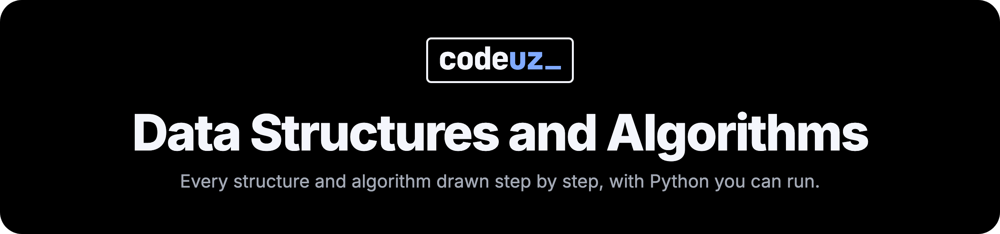

# Data Structures and Algorithms

Data structures and algorithms explained with diagrams and Python code that runs in the browser. For programming videos in Uzbek, see the [codeuz](https://youtube.com/codeuz) YouTube channel.

**[Read in English](https://codeuz-edu.github.io/data-structures-and-algorithms/)** · **[Özbekça öqiş](https://codeuz-edu.github.io/data-structures-and-algorithms/uz/)**

Lessons use diagrams and runnable Python examples to teach each structure or algorithm. Use the language menu to switch to the corresponding lesson.

## Run locally

Requires Node.js 22+.

```sh
npm ci
npm run dev
```

## Add a page

1. Add `docs/<topic>/<page>.md` and its Uzbek counterpart at `docs/uz/<topic>/<page>.md`. List both titles in `docs/.vitepress/config.mjs`. Use matching heading IDs so links to a section also work after changing languages.
2. Draw its diagrams as components in `docs/.vitepress/theme/diagrams/`. A file named `StackPush.vue` is used on a page as `<StackPush />`. Copy a `LinkedList*.vue` file for the frame, node and arrow styles.
3. Fence code that runs on its own with `python` and fragments with `py`. Only `python` blocks get a Run button.
4. Keep the starter code, solutions, and any corrections in sync across both languages. Use `::: details Solution` in English and `::: details Yeçim` in Uzbek.
5. Run `python scripts/check.py` to check runnable blocks. Run `npm run build` to check page generation and links.

## License

[MIT](LICENSE)
